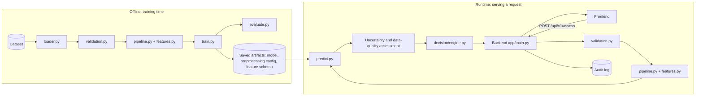
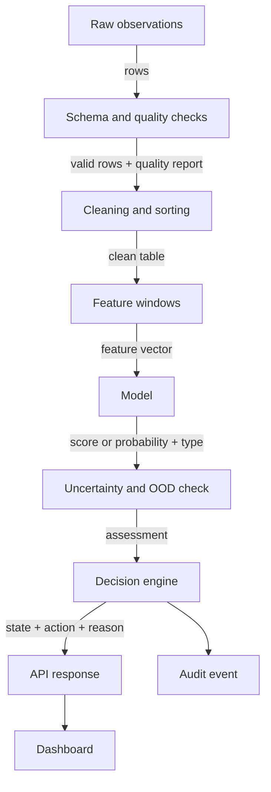
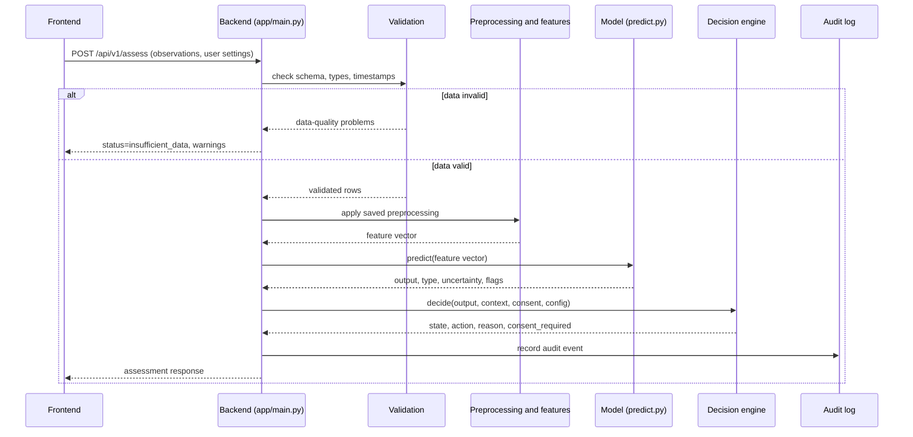
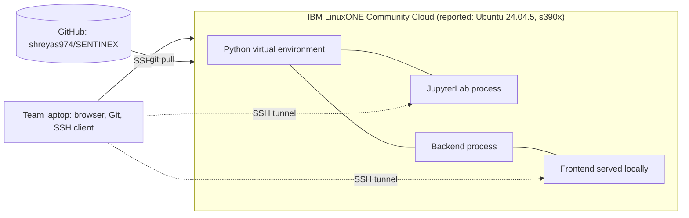
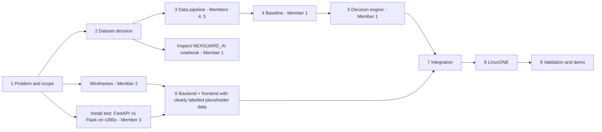

# SENTINEX Team Guidebook

**SENTINEX: Multimodal AI for Real-Time Risk Forecasting and Adaptive Intervention**
*Anticipate the Risk. Act Before It Escalates.*

Team NEUROBOTS | IBM Z Datathon 2026 | Theme 1: Real-Time AI for Critical Decisions

**Guidebook status: PART 1 of N.**
Complete in this part: Chapters 1 to 9.
Next part (Part 2): Chapter 10 Beginner learning path, Chapter 11 GitHub workflow, Chapter 12 Dataset research and selection.
After that: Part 3 (data schema, ingestion, preprocessing), Part 4 (models, evaluation, decision engine), Part 5 (backend, frontend, privacy), Part 6 (testing, LinuxONE, integration), Part 7 (milestones detail, file-by-file implementation, existing work inspection), Part 8 (documentation, presentation, troubleshooting, acceptance checklist).

---

## How to read this guidebook

### Evidence labels
Every statement in this guidebook belongs to one of these kinds. Look for the label when a claim matters.

| Label | Meaning |
|---|---|
| `[Reported fact]` | Something the team told us. Not yet re-checked by running a command. |
| `[Verified]` | Checked by actually running something. Nothing is marked this way yet. |
| `[Proposed design]` | What we plan to build. Not built. |
| `[Implemented]` | Code exists. Nothing is marked this way yet. |
| `[Tested]` | Tests were actually run and passed, with a recorded result. Nothing is marked this way yet. |
| `[Published research]` | Backed by a real source listed in `docs/REFERENCES.md`. No sources are registered yet, so none of this label is used yet. |
| `[Assumption]` | Our own guess, to be checked. |
| `[Future work]` | A possible extension, not part of the core prototype. |

### Where commands run
Every command in this guidebook is labelled with one of:
- **LinuxONE terminal** (you are logged in over SSH as `linux1`)
- **Your own computer** (Windows, macOS or Linux)
- **Jupyter notebook cell**

### Symbols used
`SENTINEX/` is the repository root. On LinuxONE this is `/home/linux1/SENTINEX` `[Reported fact]`.

---

# Chapter 1. Executive summary

## 1.1 What SENTINEX is, in one paragraph
SENTINEX is a **prototype** of a decision-support tool for personal safety. It reads a sequence of timestamped observations (for example motion-related measurements), checks that the data is trustworthy, estimates whether something concerning might be developing, says how unsure it is, and then recommends a **small, proportionate** next step such as "keep watching" or "ask the user if they are okay". It never takes drastic action on its own from an uncertain estimate.

## 1.2 What it is not
It is not a crime predictor. It does not identify dangerous people. It does not guarantee anyone's safety. It does not replace emergency services. It is a student prototype, and whether it works at all is something we find out through honest evaluation, not something we assume.

## 1.3 What we are building, in six steps
1. A **data pipeline** that loads, validates and cleans observations.
2. A **model** (starting with a simple baseline) that estimates a risk-related quantity.
3. An **uncertainty and data-quality check** that says when the estimate should not be trusted.
4. A **decision engine** that turns the estimate plus context (consent, preferences, repeated alerts) into a recommendation.
5. A **backend API and frontend dashboard** that show the result to a user.
6. A **deployment on IBM LinuxONE**, with documented, measured behaviour.

## 1.4 What makes a good result
Quality matters more than the number of features. In order of priority:
1. A clear, defensible definition of what we predict.
2. A suitable dataset we are allowed to use.
3. A reproducible baseline model.
4. Honest evaluation, including negative results.
5. A working, tested decision engine.
6. A functional backend and frontend.
7. A verified run on LinuxONE.
8. Clear documentation.
9. A strong, truthful presentation.

## 1.5 Current status ledger
| Item | Status | Evidence |
|---|---|---|
| GitHub repo and 6 branches exist | `[Reported fact]` | Not re-checked; run `git branch -a` |
| LinuxONE environment (Ubuntu 24.04.5, s390x, Python 3.12.3, user `linux1`, host `nexora`) | `[Reported fact]` | Not re-checked |
| Project directory `/home/linux1/SENTINEX` | `[Reported fact]` | Not re-checked |
| Notebook `NEXGUARD_AI.ipynb` (synthetic anomaly experiment) | Exists, not inspected | See Chapter 26 in a later part |
| Nested repo `SENTINEX/SENTINEX` with its own `.git` | Exists, unresolved | Inspect before touching |
| Dataset | Not selected | |
| Prediction target | Not defined | |
| Preprocessing, model, decision engine, API, frontend | Not started | |
| LinuxONE deployment | Not verified | |
| Any test or metric | None exist | |

## 1.6 Timing note
A third-party listing gave 18 October 2026 as the project submission deadline `[Assumption]`. It was not confirmed on an official page. Until someone confirms it, this guidebook uses **relative milestones** and never invents calendar dates.

---

# Chapter 2. Problem statement

## 2.1 Formal problem statement (suitable for a datathon proposal)

**Current limitation.** Many personal-safety tools respond after an incident has begun or after the user manually asks for help. They commonly rely on a manual trigger or a fixed threshold, which does not use how observations change over time and does not communicate how uncertain a judgement is.

**Technical challenge.** Contextual signals can change gradually before a concerning event. Turning a *sequence* of observations into a risk estimate, an honest statement of uncertainty, and a proportionate, consent-respecting recommendation is difficult. Unusual observations are common and usually harmless, so a naive system produces many false alarms, while a cautious one may miss real events. The right response depends on more than a model score.

**Intended users.** A person who has chosen to use the tool and controls their own consent settings, and a trusted contact whom that person nominates. `[Proposed design]`

**Proposed AI capability.** A pipeline that validates timestamped observations, computes features, estimates a risk-related quantity with a transparent baseline model, assesses uncertainty and data quality, and applies a configurable decision policy to recommend one of a small set of proportionate actions.

**Intended outcome.** A working, tested, documented decision-support prototype running on IBM LinuxONE, with a clearly identified dataset and measured evaluation results.

**Limitations and assumptions.**
- SENTINEX does not claim to reliably predict crime or guarantee safety.
- Whether the data supports *forecasting* (predicting a future event) or only *anomaly detection* or *classification* is decided by what the chosen dataset actually contains.
- If real labelled data cannot be obtained, synthetic data is used only to test software mechanics, and its results are never presented as real-world evidence.
- Effectiveness is determined through evaluation, not asserted.

## 2.2 One-sentence version for slides
SENTINEX is a contextual risk-assessment and decision-support prototype that estimates how concerning a sequence of observations is, says how uncertain that estimate is, and recommends a proportionate, consent-aware response.

---

# Chapter 3. The problem explained for beginners

## 3.1 The real-world situation
Imagine a friend who walks you home. They do not just react when something bad happens. They notice small changes: you walked a different route, it got late, you slowed down. They then ask a gentle question: "Everything okay?" They do not call the police at the first odd moment, and they do not assume you are in danger. SENTINEX explores a software version of that careful, step-by-step attention.

Examples of observations that *might* be relevant, if suitable data exists:
- changes in movement pattern
- route or location context
- time of day
- motion or activity features
- environmental measurements
- audio-derived features (only if suitable data exists, the use is justified, and privacy requirements can be met)
- earlier observations over time
- whether the user confirmed or dismissed an earlier alert

**Important:** none of these prove that someone is in danger. A change in movement, location or sound is only a *signal*. SENTINEX must never treat it as proof of a crime or of a dangerous person.

## 3.2 Words you need first (glossary)
Read this once before the rest. Later chapters use these words without re-explaining.

| Term | Plain meaning |
|---|---|
| **Observation** | One recorded measurement at one moment, for example "movement variation was 0.4 at 14:02:10". |
| **Timestamp** | The date and time attached to an observation. |
| **Time series** | A list of observations in time order. |
| **Feature** | A number we give to the model, usually computed from observations, such as "average movement over the last minute". |
| **Label** | The correct answer attached to a record in the data, for example "this window contained event X". |
| **Dataset** | A collection of records, often a table in a CSV file. |
| **Model** | A program that learned patterns from data and turns features into an output. |
| **Training** | Letting the model learn patterns from data. |
| **Inference** | Using an already trained model on new data. |
| **Supervised learning** | Learning from data that has labels. |
| **Unsupervised learning** | Learning from data without labels. |
| **Anomaly** | An observation or pattern that differs from the reference data. Different is not the same as dangerous. |
| **Classification** | Choosing a category for a given input. |
| **Forecasting** | Estimating whether something will happen in the future, using only information from the past and present. |
| **Prediction horizon** | How far ahead a forecast looks, for example "next 5 minutes". |
| **False positive / false alarm** | The system raises an alert but nothing concerning happened. |
| **False negative / missed event** | Something concerning happened but the system did not flag it. |
| **Uncertainty** | How unsure the system is about its own output. |
| **Calibration** | Whether a probability of "70%" really corresponds to the event happening about 70% of the time. |
| **Data leakage** | Accidentally letting the model see information it would not have in real use, which makes results look better than they are. |
| **Overfitting** | Learning the training data too closely so the model does poorly on new data. |
| **API** | A defined way for one program (the frontend) to ask another (the backend) to do work. |
| **Endpoint** | One specific address of an API, such as `/health`. |
| **JSON** | A plain-text format for sending structured data, like `{"name": "x"}`. |
| **Backend / frontend** | Backend runs logic on a server. Frontend is what the user sees. |
| **Virtual environment** | A private folder of Python packages for one project so projects do not interfere. |
| **s390x** | The processor architecture of IBM LinuxONE. Some precompiled software is not available for it, so we must verify installs. |
| **Consent** | The user's explicit choice about what the system may do. |

## 3.3 Five tasks that sound similar but are different
This is the most important idea in the project. A system that does one of these is **not** automatically doing the others.

| Task | Question it answers | Example | What it needs | What it can honestly claim |
|---|---|---|---|---|
| 1. Detect an **unusual observation** | "Is this single reading far from normal?" | One very high value | A reference for "normal" | The value is unusual. Nothing else. |
| 2. Detect an **anomalous pattern** | "Does this stretch of readings look unlike normal stretches?" | A change that builds over a minute | Windows of time-ordered data and a reference | The pattern is unusual. Not that it is dangerous. |
| 3. **Classify a labelled event** | "Which known category does this window belong to *right now*?" | "walking" vs "running" vs "event X" | Reliable labels | It recognises a condition that is present or just happened. |
| 4. **Forecast a future event** | "Will event X happen in the next N minutes?" | Warning before event X | Event timestamps, a defined horizon, strict time ordering, no future information leaking in | Only then can it say it forecasts. |
| 5. **Recommend an intervention** | "Given all of that, what should happen next?" | "Ask the user to confirm" | A decision policy, consent, context | A recommendation. It is a separate component from the model. |

**Why they are not interchangeable.** A high anomaly score means "different from the reference data". It could be a harmless stumble, a different phone position, a new route, or a broken sensor. A classifier trained on labels only recognises what those labels describe. Forecasting needs a *future* event label and the discipline that nothing from the future reaches the input. Recommending an action adds consent and consequences, which no model score contains.

## 3.4 Why a simple threshold alert may not be enough
A threshold alert says "if value > X, alert". Problems:
- It ignores history. A slowly building change and a single spike look the same to it.
- It cannot say how unsure it is.
- One noisy reading can trigger a false alarm.
- It does not consider whether the user already dismissed a similar alert, or what the user has consented to.
- A threshold chosen by guesswork is not evidence of anything.

SENTINEX does not claim to beat a threshold. It proposes to *explore* whether adding time context, uncertainty and a decision policy is useful, and to measure that honestly against a simple baseline.

## 3.5 Why this matters
- **Earlier awareness may be useful.** If a concerning pattern builds gradually, noticing it sooner could leave more options open. `[Assumption]`: this needs evidence from the chosen dataset and cannot be assumed.
- **Uncertainty matters.** A guess presented as certain misleads people.
- **False alarms harm.** They cause stress, waste a trusted contact's attention, and teach users to ignore the system.
- **Missed events matter.** A system that stays quiet when something happens fails its purpose. Reducing false alarms and reducing misses pull in opposite directions, so we must measure both.
- **Interventions must be proportionate.** Asking "are you okay?" costs little. Contacting someone else costs more. Contacting emergency services costs the most. The response must match the evidence.
- **Privacy and consent are essential.** The system observes personal context. The user must stay in control of what is collected and what is done.

## 3.6 Existing approaches (conceptual, no claims about specific products)
| Approach | How it works | Typical limitation |
|---|---|---|
| Manual user-triggered alert | User presses a button | Needs the user to be able to act, and acts only after the user decides help is needed |
| Simple threshold monitoring | Alert when a value passes a fixed limit | Ignores history and uncertainty, tends to raise false alarms |
| Reactive alert systems | Alert after an incident is detected | Responds after the event has begun |
| Basic anomaly detection | Flags data unlike a reference | Unusual does not mean concerning, and the score is not a probability |
| Context-aware decision systems | Combine several signals and rules | Quality depends on data, labels, and how the policy is designed and validated |

**What SENTINEX proposes to explore beyond a simple threshold alert:** using the *sequence* of observations, reporting uncertainty and data quality alongside any estimate, and separating the model from a transparent, configurable decision policy that respects consent. Whether this helps is a question for our evaluation.

---

# Chapter 4. Objectives and expected outcomes

Each objective has an **exit test**: how we know it is done. None are complete yet.

| # | Objective | Exit test | Status |
|---|---|---|---|
| 1 | **Contextual data processing.** Accept timestamped observations and validate them: schema, missing values, invalid values, timestamp order, duplicates, unit consistency. Record data-quality problems. Produce model-ready features. | Validation tests pass on good and deliberately bad input. A data-quality summary is produced. | Not started |
| 2 | **Anomaly or risk-signal detection.** A transparent baseline that finds patterns differing from the reference data. Decide whether anomaly detection even suits the dataset. | Baseline trains and runs reproducibly. Its suitability is argued in the model report. | Not started |
| 3 | **Risk estimation or forecasting.** Pick the method the data supports: binary or multiclass classification, anomaly detection, or forecasting. | The task matches the labels and timestamps. If there are no future-event labels, the system is labelled anomaly detection or risk-signal classification, never "predicts future danger". | Not started |
| 4 | **Uncertainty-aware assessment.** Report score or probability only when statistically justified, uncertainty where supported, data-quality warnings, out-of-distribution flag, and "insufficient evidence". | A raw anomaly score is never shown as a probability. Each uncertainty field is either implemented or explicitly "not estimated". | Not started |
| 5 | **Adaptive intervention decision.** A decision engine that uses model output, risk level, uncertainty, persistence, data quality, preferences, consent, earlier responses and consequences. | Unit tests cover normal, uncertain, missing data, repeated alerts, denied consent and model failure. No path contacts emergency services or shares location from an uncertain score alone. | Not started |
| 6 | **Integrated application.** Connect pipeline, model, risk assessment, decision engine, backend and frontend. | One request goes from the dashboard to a recommendation and back, using real component outputs. | Not started |
| 7 | **IBM LinuxONE deployment.** Run and test on the available environment. Document what runs, what was measured, and what is unverified. | Documented end-to-end run on LinuxONE with recorded environment and measurements. | Not started |
| 8 | **Evaluation.** Data quality, model quality, false alarms, missed events, decision quality, latency, reliability where applicable. | A results table filled with real measured values only. | Not started |
| 9 | **Documentation.** Enough for another person to understand, run, test and maintain the project. | A new person can follow the docs to run the tests. | Not started |

**Expected outcome.** A small, working, honestly evaluated prototype. Not a finished safety product.

---

# Chapter 5. Scope and non-goals

## 5.1 In scope
- Data validation
- Reproducible preprocessing
- Baseline anomaly detection or classification
- Forecasting only when the data supports it
- Uncertainty-aware assessment
- A transparent decision engine
- A functional frontend
- A working backend API
- Automated tests
- A LinuxONE deployment demonstration
- Documentation and measurable evaluation

## 5.2 Out of scope (unless justified and implemented)
- Guaranteed prevention of harm
- Guaranteed prediction of criminal activity
- Identifying dangerous individuals
- Automatic emergency dispatch from a model score
- Location sharing without consent
- Unnecessary raw audio or sensitive data collection
- Claims of real-world efficacy from synthetic data alone
- Claims of production readiness
- Deep learning where a baseline is enough

## 5.3 Why smaller is better
A small prototype that runs end to end, is tested, and states its limits honestly is more convincing and more useful than a large collection of half-finished features. Judges can verify a working small system. They cannot verify a promise. Each extra feature adds code to test, document and explain, and the team has limited time. So the rule is: **finish the core path first, then add optional extras only if time remains.**

---

# Chapter 6. The expected final product

## 6.1 The eleven stages
```
OBSERVE -> VALIDATE DATA -> PREPROCESS -> EXTRACT FEATURES -> ANALYZE PATTERNS
 -> ESTIMATE RISK OR FORECAST -> ASSESS UNCERTAINTY -> APPLY DECISION RULES
 -> RECOMMEND AN INTERVENTION -> DISPLAY RESULT -> RECORD AN AUDIT EVENT
```

Implementation file names below are the **proposed** layout. The file exists only when someone creates it.

| # | Stage | Purpose | Inputs | Outputs | Depends on | Proposed file | Expected behaviour | Failure cases | Tests required |
|---|---|---|---|---|---|---|---|---|---|
| 1 | Observe | Bring observations into the system | A CSV file (later, an API request body) | Raw table | Dataset or request | `src/data/loader.py` | Reads the file, returns a table, keeps the original untouched | File missing, unreadable, empty | Missing file, empty file, wrong format |
| 2 | Validate data | Decide whether data is trustworthy | Raw table, schema | Validated table and a data-quality report | Stage 1 | `src/data/validation.py` | Checks columns, types, timestamps, duplicates, ranges, units. Records every problem. Never silently drops rows | Missing columns, wrong types, bad timestamps, impossible values | One test per rule, good and bad input |
| 3 | Preprocess | Clean and standardise | Validated table | Clean table | Stage 2 | `src/preprocessing/pipeline.py` | Handles missing values, sorts by time, scales or encodes if needed. Fit on training data only | Unseen categories, all-missing columns | Reproducibility, no leakage, same output schema |
| 4 | Extract features | Build model inputs | Clean table | Feature table | Stage 3 | `src/preprocessing/features.py` | Computes window or rolling features that use only past data | Window too short, look-ahead bug | Window boundaries, no future values |
| 5 | Analyze patterns | Compare against reference | Feature table | Pattern signal | Stage 4 | `src/models/predict.py` | Uses the trained baseline | Model file missing | Loads, rejects bad input |
| 6 | Estimate risk or forecast | Produce the risk-related quantity | Pattern signal | Score or probability, with its correct type | Stage 5 | `src/models/predict.py` and, only if supported, `src/forecasting/forecast.py` | Output type is named exactly (anomaly score vs probability) | Score misreported as probability | Output type check |
| 7 | Assess uncertainty | State how reliable the output is | Output, feature table, data-quality report | Uncertainty info, out-of-distribution flag, insufficient-evidence flag | Stage 6 | `src/models/predict.py` (assessment helper) | Says "not estimated" when it is not | Claiming uncertainty that was not computed | Flag appears when data is poor |
| 8 | Apply decision rules | Choose a response state | Assessment, user context | Decision state | Stage 7, user settings | `src/decision/engine.py` | Configurable, documented thresholds. Cooldown and hysteresis | Missing consent, invalid input | Normal, uncertain, missing data, repeats, denied consent, model failure |
| 9 | Recommend intervention | Express the action and its reason | Decision state | Recommended action, explanation, `consent_required` | Stage 8 | `src/decision/engine.py` | Only proposes actions the app can actually perform and the user authorised | Escalation without consent | No-escalation tests |
| 10 | Display result | Show it to the user | API response | Dashboard view | Stage 9, backend | `app/` (frontend) and `app/main.py` (backend) | Shows uncertainty, data quality, explanation, controls. Distinguishes synthetic demo data | API error, missing fields | Loading, error, empty, success states |
| 11 | Record audit event | Keep a safe, minimal record | Request id, decision, time | Log entry | Stage 9 | `src/monitoring/logging_config.py` | Logs the decision and reason, not unnecessary personal data | Logging raw sensitive data | Log content test |

## 6.2 About data used in the demo
The prototype must run end to end on a **clearly identified, legally usable dataset**. If real labelled data cannot be obtained in time, we use a **clearly labelled synthetic dataset** to test the software mechanics only. Synthetic results are never evidence of real-world predictive effectiveness, and the interface must say so.

---

# Chapter 7. System architecture

## 7.1 Design principles
1. **Simple.** One backend process, one frontend, optional SQLite only if persistence is required. No microservices, Kubernetes or streaming system unless a concrete requirement appears.
2. **Separate training from runtime.** Training happens offline. The running application only loads the saved result.
3. **One definition of features.** Training and inference use the same code and the same saved configuration.
4. **Model is not policy.** The model estimates. The decision engine decides.
5. **Honest outputs.** Each output field is either real or explicitly empty.

## 7.2 High-level architecture `[Proposed design]`


## 7.3 Data-flow diagram `[Proposed design]`


## 7.4 Sequence of one request `[Proposed design]`


## 7.5 Deployment diagram `[Proposed design]`

Notes: the SSH tunnel is a *separate process* from JupyterLab. Neither Jupyter nor the development servers are exposed publicly without a security review. All of this is a plan until it is verified.

## 7.6 Training time versus runtime
| | Training time | Runtime |
|---|---|---|
| When | Rarely, by a team member | On every request |
| What happens | Learn from a dataset, evaluate, save artifacts | Load artifacts, transform input, predict, decide |
| Speed matters? | Not much | Yes |
| Output | Saved model, preprocessing config, feature schema, metrics | An assessment response |

**Why we never retrain on every request.** Training is slow, needs a whole dataset, and a single request is one data point. Retraining on it would make results unrepeatable, let one bad input change the model, and make latency unpredictable. Instead we train once, **save** the model, and **load** it at startup.

## 7.7 Keeping training and inference consistent
- Preprocessing and feature code lives in one module used by both paths.
- Anything learned during training (for example scaling parameters) is saved with the model in one artifact folder.
- A **feature schema file** lists the feature names, order and types. The runtime checks incoming features against it.
- The saved artifact records the model version, dataset version and preprocessing version, returned as `model_version` in the API.
- A test feeds the same raw input through the training path and the runtime path and requires identical features.

## 7.8 Interface preview (proposed, so later code stays consistent)
These names are a **proposal**. Chapters in later parts build on them. Change them only through a team decision recorded in `docs/API_CONTRACT.md`.

| Module | Function | Takes | Returns |
|---|---|---|---|
| `src/data/loader.py` | `load_csv(path)` | file path | table |
| `src/data/validation.py` | `validate(table, schema)` | table, schema | `ValidationReport` (list of issues, counts, `is_usable`) |
| `src/preprocessing/pipeline.py` | `fit(train_table)` and `transform(table)` | tables | clean table (saved config reused at runtime) |
| `src/preprocessing/features.py` | `build_features(clean_table, window)` | clean table | feature table |
| `src/models/predict.py` | `predict(features)` | feature table | `ModelOutput` (value, `output_type`, uncertainty, `out_of_distribution`, `insufficient_evidence`, `model_version`) |
| `src/decision/engine.py` | `decide(model_output, context, config)` | output, user context, config | `Decision` (state, action, reason, `consent_required`) |
| `src/monitoring/logging_config.py` | `log_audit_event(...)` | decision data | writes one safe log record |
| `app/main.py` | endpoints | HTTP requests | JSON responses |

Decision states (shared vocabulary): `INSUFFICIENT_DATA`, `NORMAL_MONITORING`, `NEEDS_VERIFICATION`, `ELEVATED_SIGNAL`, `USER_AUTHORIZED_ASSISTANCE`.

API endpoints (proposed): `GET /health`, `POST /api/v1/assess`, `GET /api/v1/config`.

## 7.9 Technology choices (summary here, details in a later part)
| Technology | Why | Status |
|---|---|---|
| Python 3.12 `[Reported fact]` | Already on the server | Version not re-checked |
| NumPy, Pandas | Tables and numbers | Install on s390x not verified |
| scikit-learn | Simple baselines (for example Isolation Forest, Logistic Regression) | Not verified on s390x |
| Matplotlib | Charts from real results | Not verified |
| FastAPI or Flask | Backend. Pick **one** after an install test on s390x | Undecided |
| Streamlit or plain HTML/JS | Frontend. Choose after the backend choice and the team's skills | Undecided |
| pytest | Tests | Not verified |
| SQLite | Only if persistence is needed | Probably not needed |
| Git and GitHub | Collaboration | Reported in use |

Rule: **install the smallest set that works**, and verify each install before relying on it.

---

# Chapter 8. Team responsibilities

## 8.1 Overview
| Member | Role | Main branch | Main folders |
|---|---|---|---|
| 1 | Team lead, AI/ML lead, integration lead, Documentation Master, research coordinator | `feature/ai-ml` | `src/models/`, `src/forecasting/`, `src/decision/`, `docs/` |
| 2 | Frontend developer | `feature/frontend` | `app/` (frontend part) |
| 3 | Backend developer and documentation support | `feature/backend-docs` | `app/main.py`, `src/monitoring/`, `docs/API_CONTRACT.md`, `docs/DEPLOYMENT_GUIDE.md` |
| 4 | Data engineer part 1: dataset research, ingestion, validation | `feature/data-validation` | `src/data/`, `docs/DATASET_REPORT.md` |
| 5 | Data engineer part 2: preprocessing, features, pipeline | `feature/preprocessing` | `src/preprocessing/` |

## 8.2 Member 1: what the role means
You are responsible for the whole picture: that the problem is understood, the pieces fit, and every claim is backed by evidence. You also do the core AI/ML work and own the guidebook.

Tasks (high level, detailed in later parts): understand the full problem; maintain this guidebook; coordinate research; approve the dataset choice *with the team*; define the feature schema; lead baseline model work; coordinate uncertainty and the decision engine; agree the API contract with Member 3; coordinate integration; review pull requests; track milestones and blockers; check that presentation claims are supported; coordinate final testing and the demo.

**Avoiding being a single point of failure.** The lead carries the most load, so deliberately share it:
- **Pair each critical area with a backup:** integration (1 and 3), API contract (3 and 2), data contract (4 and 5), documentation (1 and 3).
- **Small documentation pull requests** (typos, tables, test reports) can be reviewed and merged by Member 3 so Member 1 is not the only gate. Pull requests that change the data contract, API contract or decision rules need Member 1 plus the affected owner.
- **Written interfaces first.** If every module's inputs and outputs are written down, another member can pick up unfinished work.
- **Daily blocker list** in one shared place. Anyone can add; the lead only decides priorities.
- **Delegate with a definition of done.** Hand over a task with its test, not just its title.
- **Decisions are recorded** in the docs, not stored in the lead's head.

## 8.3 Member 2: Frontend developer, in simple language
You build what the user sees. Your job is to show a result truthfully: never more certain than it is, never calling a person dangerous, always showing data quality, and giving the user controls. Tasks: understand the user journey, build the interface, display risk, uncertainty and recommended actions, add consent controls, handle loading, empty, success and error states, connect to the backend, test the integration, and label synthetic demo data.

## 8.4 Member 3: Backend developer and documentation support
You build the API that connects everything. Tasks: define and implement endpoints, validate input, call preprocessing, model and decision components, return structured responses, handle errors, implement audit logging if required, document requests and responses, support integration and deployment.

## 8.5 Member 4: Data engineer part 1
You find, check and bring in the data. Tasks: research candidate datasets, verify source and license, document characteristics, identify labels, timestamps, units and limitations, access data only through permitted methods, write the data dictionary, implement ingestion and validation, and report data limitations honestly to Member 1.

## 8.6 Member 5: Data engineer part 2
You make the data model-ready. Tasks: handle missing values, duplicates and timestamps, build reproducible preprocessing, define feature transformations, prevent data leakage, create model-ready datasets, write preprocessing tests, document features and transformations.

## 8.7 Decisions the whole team must make together
1. The exact problem and target event.
2. The dataset.
3. The prediction task (anomaly, classification, forecasting).
4. The data contract between Members 4 and 5.
5. The feature schema between Members 5 and 1.
6. The API contract between Members 1, 2 and 3.
7. The decision policy and its thresholds (as illustrative, configurable values).
8. Backend framework and frontend approach.
9. What the demo will show.
10. What claims the presentation may make.

Each decision is written into the matching document and announced to everyone before code depends on it.

---

# Chapter 9. Development roadmap

Because the real deadline is unconfirmed, the roadmap uses **relative milestones** `[Assumption]`. If the real window is very short, do milestones 1 to 5 minimally and favour the core path.

| Milestone | Goal | Deliverables | Definition of done | Main owners |
|---|---|---|---|---|
| 1 | Problem and scope agreement | Problem statement, objectives, scope, initial architecture | Everyone can state the problem in two sentences and the non-goals | 1 (all) |
| 2 | Research and dataset selection | Dataset comparison, source and license record, data dictionary, dataset decision | One dataset (or labelled synthetic fallback) chosen, license checked, task matched to labels and timestamps | 4, 1 |
| 3 | Reproducible data pipeline | Ingestion, validation, preprocessing, unit tests | Pipeline runs twice on the same data and gives identical output. Tests pass (actually run) | 4, 5 |
| 4 | Working baseline | Baseline model or detector, evaluation notebook, reproducible experiment, honest results | Baseline trains from a clean checkout. Real metrics recorded with method and limits | 1 |
| 5 | Decision engine | Configurable rules, uncertainty handling, consent checks, unit tests | All six test scenarios pass (normal, uncertain, missing data, repeats, denied consent, model failure) | 1 |
| 6 | Backend and frontend | API, UI, API contract, initial integration | UI shows a real backend response | 2, 3 |
| 7 | Full system integration | End-to-end workflow, integration tests, error handling | One request flows UI to decision and back, errors handled visibly | 1, 3, 2 |
| 8 | LinuxONE deployment | Working deployment, environment report, performance measurements, known limitations | App runs on LinuxONE, measurements recorded with method | 1, 3 |
| 9 | Final validation and demo | Test report, model report, final docs, presentation, demo script, backup demo plan | Demo rehearsed from clean start, every claim has evidence | All |

## 9.1 What can happen in parallel

Placeholders are used **only during early development** and must be labelled. They are replaced by real backend responses at integration.

## 9.2 Immediate next actions (before any code)
1. Run the read-only inspection commands (see the earlier message) on LinuxONE and share the output: current branch, remotes, nested repo state, notebook location, installed packages.
2. Confirm the official deadline and submission format.
3. Member 4 starts the dataset comparison table using the framework in Chapter 12 (Part 2).
4. Member 3 runs a scratch install test of FastAPI and Flask on s390x and reports.
5. Member 2 sketches the wireframes.
6. Decide the nested-repo handling only after inspecting it. Do not delete either copy.

---

**End of Part 1.**
Chapters complete: 1 Executive summary, 2 Problem statement, 3 Problem explained for beginners, 4 Objectives, 5 Scope and non-goals, 6 Expected final product, 7 System architecture, 8 Team responsibilities, 9 Development roadmap.
Next: Part 2 covers Chapter 10 (beginner learning path), Chapter 11 (GitHub workflow with exact commands for every teammate situation), and Chapter 12 (dataset research and selection framework with the comparison table and decision template).
Terminology, state names, file names and the interface preview in Chapter 7.8 stay fixed across all parts unless the team records a change.
